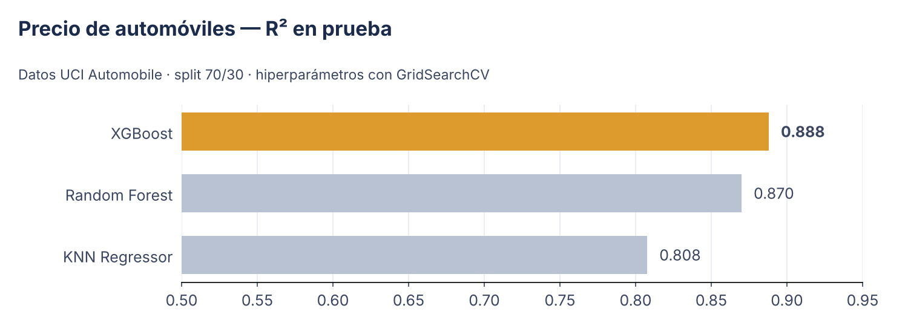
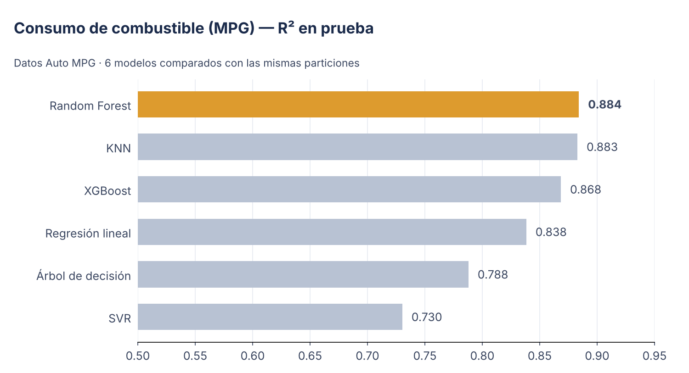
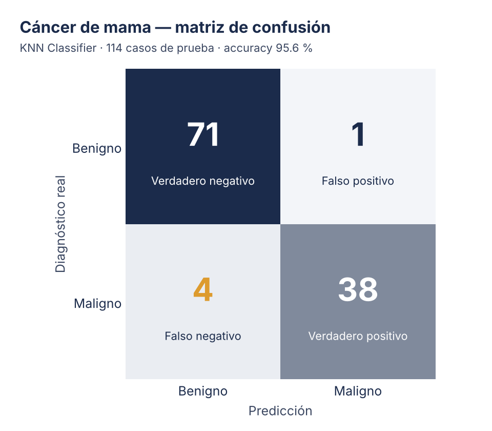

<p align="center">
  
  
  
  
  
  
</p>

Tres casos de aprendizaje supervisado desarrollados de principio a fin con la metodología **CRISP-DM**: entender el problema, limpiar y preparar los datos, comparar modelos con métricas objetivas y traducir el resultado en una conclusión accionable.

> El mismo criterio que aplico en mejora continua: **medir antes de decidir**. Cada modelo se evalúa con datos que no vio durante el entrenamiento, y la elección final se justifica con números.

---

## 📊 Resumen de resultados

| # | Proyecto | Tipo | Modelos comparados | Mejor resultado |
|:-:|---|---|---|---|
| 01 | [Precio de automóviles](notebooks/01-precio-automoviles.ipynb) | Regresión | Regresión lineal, KNN, Random Forest, XGBoost | **XGBoost · R² 0.888 · MAE $1,222** |
| 02 | [Consumo de combustible (MPG)](notebooks/02-consumo-combustible-mpg.ipynb) | Regresión | Lineal, Árbol, Random Forest, KNN, SVR, XGBoost | **Random Forest · R² 0.884 · RMSE 2.58 MPG** |
| 03 | [Diagnóstico de cáncer de mama](notebooks/03-cancer-mama-knn.ipynb) | Clasificación | KNN Classifier | **Accuracy 95.6 % · F1 0.96** |

---

## 01 · Predicción del precio de automóviles

**Pregunta de negocio:** ¿qué precio de mercado corresponde a un vehículo según sus características técnicas?

**Datos:** [UCI Automobile](https://archive.ics.uci.edu/dataset/10/automobile) — 205 vehículos, 26 variables (se descarga directamente desde el notebook).

**Qué hice**
- Tratamiento de nulos (`?` → NaN), estandarización Z-score y codificación one-hot de variables categóricas.
- Análisis univariante con regresión lineal simple para interpretar el efecto de cada variable (p. ej., cada unidad de cilindrada suma ~$162 al precio).
- Modelos multivariantes con búsqueda de hiperparámetros (`GridSearchCV`, validación cruzada de 5 pliegues).



**Hallazgo clave:** el tamaño del motor, el peso en vacío y el ancho del vehículo concentran la mayor parte del poder predictivo. XGBoost reduce el error absoluto medio a ~$1,222 por vehículo.

---

## 02 · Comparación de modelos para consumo de combustible

**Pregunta de negocio:** ¿qué tan eficiente será un vehículo (millas por galón) a partir de sus especificaciones mecánicas?

**Datos:** [Auto MPG](https://archive.ics.uci.edu/dataset/9/auto+mpg) — 398 vehículos (archivo `auto-mpg.csv`).

**Qué hice**
- Auditoría de calidad de datos (nulos, vacíos, infinitos, símbolos) y análisis descriptivo.
- Seis algoritmos entrenados y evaluados bajo las mismas particiones (70/30) y el mismo escalado.
- Importancia de variables y simulación de una predicción para un vehículo nuevo (30.7 MPG, por encima del promedio del dataset de 23.5).



**Hallazgo clave:** la cilindrada (`displacement`) explica casi la mitad de la importancia del modelo, seguida del peso. Random Forest y KNN quedan prácticamente empatados; los modelos lineales y SVR no capturan bien las relaciones no lineales.

---

## 03 · Clasificación de tumores con KNN

**Pregunta de negocio:** ¿puede un modelo apoyar la detección temprana clasificando tumores como benignos o malignos?

**Datos:** [Breast Cancer Wisconsin (Diagnostic)](https://archive.ics.uci.edu/dataset/17/breast+cancer+wisconsin+diagnostic) — 569 biopsias, 30 características celulares (archivo `data.csv`).

**Qué hice**
- Recorrido completo de las 6 fases de CRISP-DM, desde la comprensión del problema hasta una predicción de despliegue.
- Depuración de columnas sin valor predictivo, codificación de la variable objetivo y doble control de calidad de datos.
- Escalado de variables (clave para un algoritmo basado en distancias) y evaluación con matriz de confusión y reporte de clasificación.



**Hallazgo clave:** 109 de 114 casos clasificados correctamente. En un contexto médico el error que más importa es el **falso negativo** (4 casos malignos clasificados como benignos, recall 0.90); el siguiente paso es ajustar el umbral o ponderar la clase maligna para reducirlo.

---

## 🗂️ Estructura

```
portafolio-machine-learning/
├── notebooks/
│   ├── 01-precio-automoviles.ipynb
│   ├── 02-consumo-combustible-mpg.ipynb
│   └── 03-cancer-mama-knn.ipynb
├── assets/            # banner y gráficos del README
├── requirements.txt
└── LICENSE
```

## ▶️ Cómo ejecutarlo

```bash
git clone https://github.com/EfrenCherres/portafolio-machine-learning.git
cd portafolio-machine-learning
pip install -r requirements.txt
jupyter lab
```

El notebook 01 descarga sus datos automáticamente. Para el 02 y el 03, descarga `auto-mpg.csv` y `data.csv` de los enlaces indicados y colócalos junto al notebook (o súbelos a Google Colab).

---

<p align="center">
  <b>Efren Cherres Bowen</b> · ECHB Consulting & Think Analytics<br>
  <i>Calidad que se mide. Datos que mejoran.</i><br><br>
  <a href="https://github.com/EfrenCherres">GitHub</a> ·
  <a href="https://www.linkedin.com/in/efren-cherres-06a60271">LinkedIn</a> ·
  <a href="https://orcid.org/0009-0006-1687-1187">ORCID</a>
</p>
